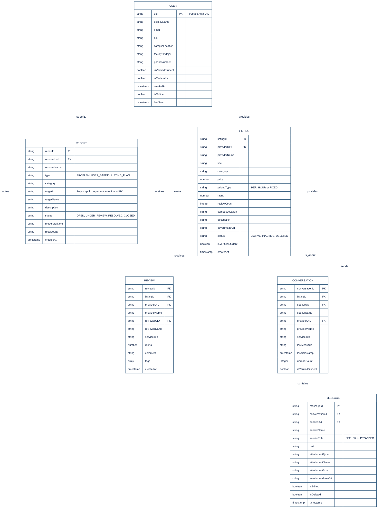

# CampusHive

**CampusHive** is a peer-to-peer student service marketplace and campus collaboration Android application built with **Kotlin**, **Jetpack Compose**, and **Firebase**. Designed for university communities (such as HELP University Subang 2 Campus), CampusHive enables verified students to offer and book campus gigs, communicate via real-time chat with file/image attachments, rate and review student providers, and maintain platform trust through an integrated Helpdesk and Moderator workflow.

---

## Key Features

### 1. Student Authentication & Verification (`AuthViewModel`)
* **Campus Email & Google Sign-In**: Supports email/password registration and Google OAuth restricted to approved domains (`@helplive.edu.my` and `@gmail.com`).
* **Strong Password Enforcement**: Requires 8+ characters with uppercase, lowercase, and special characters.
* **Student Verification & Presence**: Sends automated email verification links, displays verified student badges, and tracks real-time online/offline status (`isOnline` and `lastSeen`) synced with `MainActivity` lifecycle callbacks.

### 2. Peer-to-Peer Service Marketplace (`ListingViewModel`, `FirestoreRepository`)
* **Service Categories**: Supports **Tutoring**, **Design**, **Tech Help**, **Errands**, and **Others** with custom iconography and pricing models (`PER_HOUR` or `FIXED`).
* **Full Listing Lifecycle**: Students can publish new service listings, edit details, pause/resume visibility (`ACTIVE` vs. `INACTIVE`), or soft-delete listings (`DELETED`) with zero-latency optimistic UI updates.
* **Smart Search & Filtering**: Filter by category, campus location, or keyword search with instant focus navigation from the Home screen.

### 3. Real-Time Messaging & Attachments (`ChatViewModel`)
* **1-on-1 Service Conversations**: Deterministic conversation threads (`listingId_seekerUid`) linking Service Seekers and Service Providers around specific listings.
* **Rich Messaging**: Supports real-time text messaging, image and document attachments (`IMAGE` / `FILE` encoded in Base64), message editing (`isEdited`), and soft deletion (`isDeleted`).
* **Live Counterpart Presence**: Displays real-time online indicators and last-seen timestamps in chat headers.

### 4. Ratings & Reviews (`ReviewViewModel`)
* **Verified Feedback**: Seekers can rate completed services (1.0–5.0 stars), attach feedback tags, and write comments.
* **Automated Rating Aggregation**: Submitting a review automatically recalculates and updates the parent listing's average `rating` and `reviewCount` in Cloud Firestore.

### 5. Campus Helpdesk & Moderation (`HelpdeskViewModel`)
* **Safety & Issue Reporting**: Students can submit general support tickets (`PROBLEM`), report user safety concerns (`USER_SAFETY`), or flag inappropriate listings (`LISTING_FLAG`).
* **Moderator Queue**: Designated campus moderators can inspect all campus reports, update ticket statuses (`OPEN`, `UNDER_REVIEW`, `RESOLVED`, `CLOSED`), attach official resolution notes, and directly pause, restore, or remove flagged listings.

---

## Tech Stack & Architecture

* **Language**: Kotlin
* **UI Framework**: Jetpack Compose (Material 3, custom `Ink` / `Cream` / `HoneyTint` design system, spring-based navigation transitions, and tactile bounce modifiers)
* **Architecture**: MVVM (Model-View-ViewModel) with reactive Kotlin `StateFlow` and `callbackFlow`
* **Navigation**: Jetpack Navigation Compose (`NavGraph.kt`)
* **Backend & Database**:
  * **Firebase Authentication** (Email/Password & Google Sign-In)
  * **Cloud Firestore** (Real-time NoSQL document & subcollection synchronization)

---

## Project Structure

```text
com.example.campushive/
├── MainActivity.kt                  # App entry point & online presence lifecycle tracking
├── data/
│   └── FirestoreRepository.kt       # Cloud Firestore CRUD & real-time SnapshotListeners
├── model/
│   ├── UserProfile.kt               # Student profile & moderator flags
│   ├── Listing.kt                   # Service listing model, PricingType & CategoryVisuals
│   ├── ChatConversation.kt          # Conversation metadata & participant roles
│   ├── ChatMessage.kt               # Individual chat message & attachment model
│   ├── Review.kt                    # Service rating, comment & feedback tags
│   └── HelpReport.kt                # Helpdesk ticket, ReportType & ReportStatus enums
├── viewmodel/
│   ├── AuthViewModel.kt             # Authentication, profile updates & presence sync
│   ├── ListingViewModel.kt          # Marketplace listings & category filtering state
│   ├── ChatViewModel.kt             # Real-time conversations, messages & attachments
│   ├── ReviewViewModel.kt           # Review submission & provider/listing review streams
│   └── HelpdeskViewModel.kt         # Student reporting & Moderator queue management
├── navigation/
│   └── NavGraph.kt                  # Compose NavHost routes & screen transitions
├── components/
│   ├── BottomBar.kt                 # Main navigation bar with unread badges
│   ├── DesignSystemComponents.kt    # Reusable cards, buttons, badges & inputs
│   ├── EditListingDialog.kt         # Modal for editing existing listings
│   ├── EditProfileDialog.kt         # Modal for updating student profile info
│   ├── ListingCard.kt               # Marketplace service card component
│   ├── ReportDialog.kt              # Flagging & reporting modal
│   ├── ReviewDialog.kt              # Quick review modal
│   └── ServiceCategoryIconBox.kt    # Category icon badge component
├── screen/
│   ├── LoginScreen.kt               # Student login & password reset UI
│   ├── SignupScreen.kt              # Student registration UI
│   ├── HomeScreen.kt                # Dashboard, category shortcuts & featured services
│   ├── SearchScreen.kt              # Search bar & category filter feed
│   ├── ServiceDetailScreen.kt       # Full listing details, provider info & reviews
│   ├── CreateServiceScreen.kt       # Form to publish a new campus service
│   ├── ChatsScreen.kt               # Active conversations list
│   ├── ChatDetailScreen.kt          # Real-time chat room with file/image sharing
│   ├── ReviewScreen.kt              # Dedicated screen for submitting service reviews
│   ├── ProfileScreen.kt             # Student profile, managed listings & reviews tab
│   ├── HelpdeskScreen.kt            # Helpdesk hub & support ticket creation
│   ├── MyReportsScreen.kt           # Student reports list & Moderator queue tabs
│   └── ReportDetailScreen.kt        # Ticket details & Moderator resolution controls
└── ui/theme/
    ├── Color.kt                     # Charcoal, Cream & HoneyTint color palette
    ├── Theme.kt                     # Material 3 theme configuration
    ├── Type.kt                      # Typography definitions
    └── BounceModifier.kt            # Spring-physics press animation modifier
```

---

## Database Schema (Cloud Firestore ERD)

CampusHive uses 5 top-level collections (`users`, `listings`, `conversations`, `reviews`, `reports`) and 1 nested subcollection (`conversations/{conversationId}/messages`).



---

## Getting Started

### Prerequisites
* **Android Studio** Ladybug (or newer)
* **JDK 11+** and **Android SDK 34+**
* A **Firebase Project** with **Authentication** (Email/Password & Google Sign-In) and **Cloud Firestore** enabled

### Setup Instructions
1. **Clone the repository** and open the `CampusHiveMain` project in Android Studio.
2. **Configure Firebase**:
   * Download your `google-services.json` file from the Firebase Console.
   * Place `google-services.json` inside the `app/` directory.
   * Ensure your Android debug/release SHA-1 fingerprint is registered in Firebase Project Settings if using Google Sign-In.
3. **Build and Run**:
   * Sync Gradle dependencies in Android Studio.
   * Select an emulator or physical Android device and click **Run (`Shift + F10` / `^R`)**.
